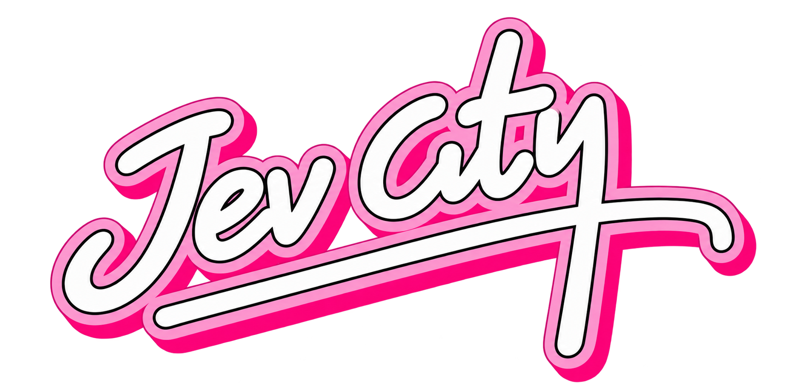

<p align="center"></p>

# JevCity · night drive

Drop photos onto a neon night road and watch a self-driving car react. A vision model **in your browser** describes each photo, and a decision model picks what the car does: stop, slow down, wait for green, obey a speed sign…

```
photo ─► Florence-2 (in browser) ─► caption ─► "[zone] caption" ─► ob-road or Jev ─► action ─► the car drives
```

Photos never leave your browser. Only the caption text goes to Jev, and only if you choose Jev.

## Two decision models

Pick one in the header.

| | **ob-road** (default) | **Jev** |
|---|---|---|
| What | Our own classifier (MiniLM, fine-tuned) | [TypeSafe Jev](https://docs.typesafe.ai) |
| Runs | In your browser | Through `/api/decide` on the server |
| Speed | ~2 ms | one API call |
| Key | None | Your own Jev token |

**Your Jev token:** paste it, click **Test**. If it works, the box collapses to "Jev connected · ••••abcd" with an **Edit** button. The token stays in the tab's memory only. It is sent with each Jev request and is never saved or logged. Reloading the page clears it.

If the model can't answer, the game falls back to simple keyword rules (`src/game/offline.ts`), so it stays playable.

## Run

```bash
pnpm install
pnpm dev
```

Open http://localhost:3000. The first visit downloads Florence-2 (about 228 MB on CPU, 357 MB with WebGPU). The browser keeps it after that.

## Play

- **Drag** a sample or your own image onto the road. Where you drop it is the zone:
  far sidewalk · oncoming lane · your lane · near sidewalk.
- **Click** a sample to drop it in your lane.
- **Add your own images** with "+ Your images", or drop image files on the tray.
- **Cruise − / +** sets the car's speed.
- The **radio log** shows the caption, what the model thinks it is, the action, and how sure it is.

## Train ob-road yourself

The model is already in `public/models/driving-clf/`. To retrain it:

```bash
pip install torch transformers onnx onnxruntime
cd driving_dataset_new
python generate_dataset.py      # makes the training data (~160k rows)
python train_model.py           # ~10 min on Apple Silicon, exports to public/models/driving-clf/
```

Reload the page to use the new model. See [`driving_dataset_new/README.md`](driving_dataset_new/README.md) for how the data is built and how to test on real photos.

## Project layout

| Path | What |
|---|---|
| `src/app/Drive.tsx` | The page: road, sample tray, radio log, model picker |
| `src/vision/` | Web Worker that runs Florence-2 and the ob-road model |
| `src/shared/localDecide.ts` | Turns ob-road's output into a game action |
| `src/app/api/decide/` | Server proxy to Jev (uses the token from the request) |
| `src/game/` | Game engine, drawing, offline rules |
| `public/models/driving-clf/` | The trained ob-road model (ONNX, 8-bit, 23 MB) |
| `driving_dataset_new/` | Dataset generator, training and test scripts |

## Known limits

ob-road is trained on made-up captions written in Florence-2's style, not on real photos. It scores ~100% on its own test set, but that says little about real use. Some real photos will still get the wrong action. To measure it, label real photos and run `evaluate.py` (steps in the dataset README).

## Credits

- Vision: [Florence-2-base-ft](https://huggingface.co/onnx-community/Florence-2-base-ft) via [Transformers.js](https://github.com/huggingface/transformers.js)
- ob-road base model: [all-MiniLM-L6-v2](https://huggingface.co/sentence-transformers/all-MiniLM-L6-v2)
- Decisions (optional): [TypeSafe Jev](https://docs.typesafe.ai)
